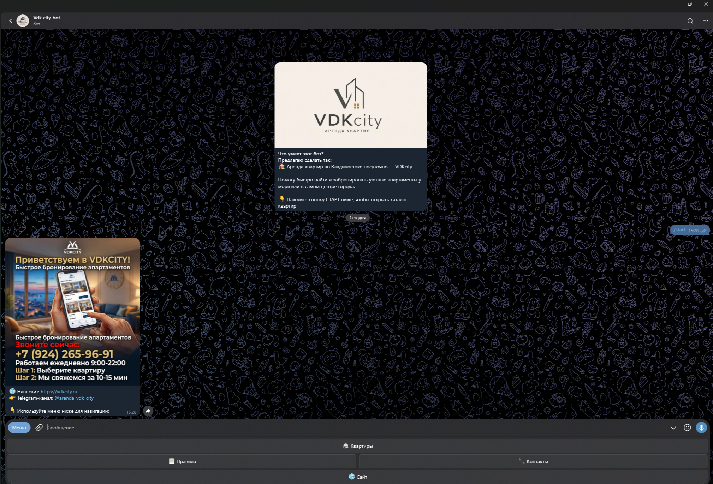
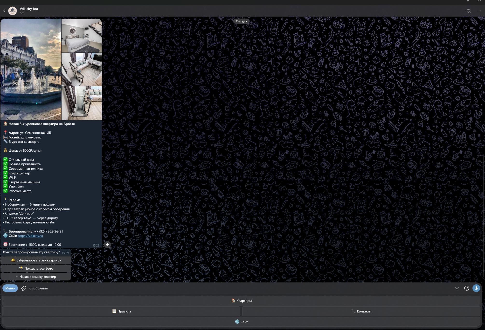
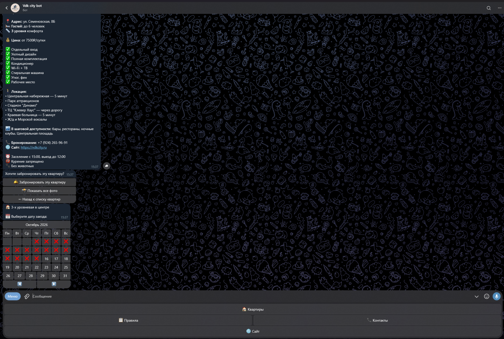
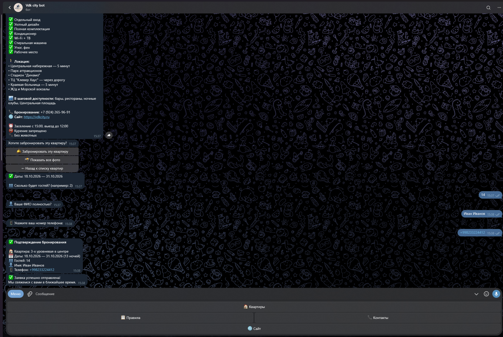
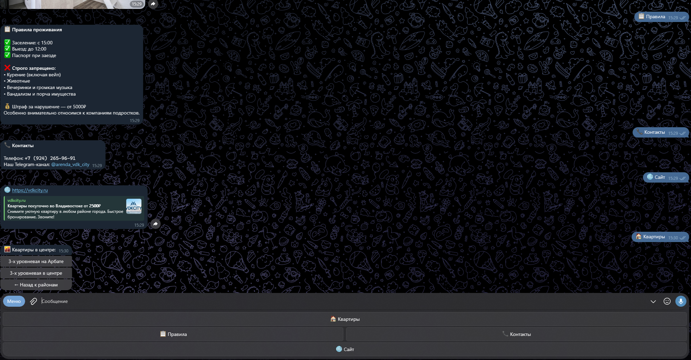
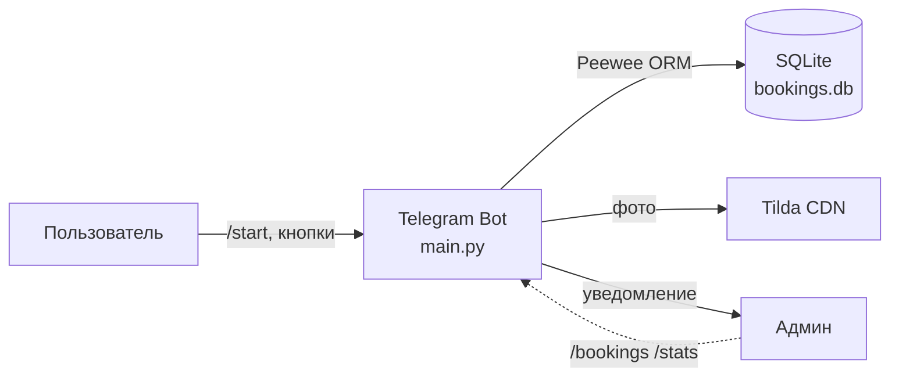

# 🤖 VDKcity Telegram Bot

Бот для поиска и посуточного бронирования квартир во Владивостоке.
Пользователь выбирает район, квартиру, даты через календарь и оставляет
заявку — администратор получает уведомление в Telegram.

Проект интегрирован с лендингом на Tilda: **vdkcity.ru**.


---

## 📸 Скриншоты

<table>
  <tr>
    <td></td>
    <td></td>
  </tr>
  <tr>
    <td align="center"><b>/start — приветствие</b></td>
    <td align="center"><b>Карточка квартиры</b></td>
  </tr>
  <tr>
    <td></td>
    <td></td>
  </tr>
  <tr>
    <td align="center"><b>Выбор дат</b></td>
    <td align="center"><b>Подтверждение бронирования</b></td>
  </tr>
  <tr>
    <td colspan="2"></td>
  </tr>
  <tr>
    <td colspan="2" align="center"><b>Reply-клавиатура и меню</b></td>
  </tr>
</table>

---

## ✨ Возможности

- 🏠 **Просмотр квартир** — навигация по районам через Reply и Inline кнопки.
- 📅 **Выбор дат** — интерактивный календарь для заезда и выезда.
- 📝 **Пошаговое бронирование** — диалог для сбора имени, телефона, числа гостей.
- 🔔 **Уведомление админа** — новая заявка моментально уходит владельцу.
- 📂 **История** — пользователь может посмотреть свои прошлые заявки.

---

## 🏗 Архитектура



- **main.py** — точка входа, регистрация хендлеров, retry-цикл, маскировка токена.
- **handlers/** — обработчики: команды, меню, бронирование.
- **keyboards/** — Reply и Inline клавиатуры.
- **utils/** — база данных, календарь, данные квартир.
- **config_data/** — конфигурация из `.env`.

---

## 🛠 Технологии

| Слой      | Технология                              |
|-----------|-----------------------------------------|
| Язык      | Python 3.12+ (проверено на 3.12 и 3.14) |
| Фреймворк | python-telegram-bot 21.10               |
| ORM       | Peewee 4.x                              |
| БД        | SQLite (`data/bookings.db`)             |
| HTTP      | httpx 0.28                              |
| Конфиг    | python-dotenv                           |
| Контейнер | Docker                                  |

---

## 📋 Команды

### 👤 Пользовательские

- `/start` — главное меню.
- `/help` — справка.
- `/history` — история ваших заявок.

### 👑 Административные (только для `ADMIN_ID`)

- `/bookings` — список всех заявок.
- `/stats` — статистика бронирований.
- `/find` — найти заявку по ID.

---

## 🚀 Установка и запуск

```bash
# 1. Клонируем репозиторий
git clone https://github.com/leniksergey/vdkcity-telegram-bot.git
cd vdkcity-telegram-bot

# 2. Создаём и активируем виртуальное окружение
python -m venv .venv

# Windows:
.venv\Scripts\activate
# Linux / macOS:
# source .venv/bin/activate

# 3. Устанавливаем зависимости
pip install -r requirements.txt

# 4. Копируем .env.example в .env
copy .env.example .env      # Windows
# cp .env.example .env      # Linux / macOS

# 5. Редактируем .env (см. ниже)

# 6. Запускаем
python main.py
```

### Переменные окружения (`.env`)

| Переменная         | Описание                                                              |
|--------------------|-----------------------------------------------------------------------|
| `TOKEN`            | Токен бота от [@BotFather](https://t.me/BotFather)                    |
| `ADMIN_ID`         | Ваш Telegram ID ([@userinfobot](https://t.me/userinfobot))            |
| `LOG_LEVEL`        | Уровень логирования (`INFO`, `DEBUG`, `WARNING`). По умолчанию `INFO` |
| `WEBSITE`          | URL сайта (по умолчанию `https://vdkcity.ru`)                         |
| `TELEGRAM_CHANNEL` | Канал проекта (по умолчанию `@arenda_vdk_city`)                       |

> ⚠️ Файл `.env` **не должен** попадать в git — он уже в `.gitignore`.

---

## 🐳 Docker

```bash
docker build -t vdkcity-bot .
docker run -d --env-file .env -v vdkcity_data:/app/data --name vdkcity-bot vdkcity-bot
```

Токен передаётся через `.env` и в образ не попадает.

### Хранение данных

`bookings.db` создаётся в `/app/data`. Без volume **данные теряются**
при пересоздании контейнера. С volume (`-v vdkcity_data:/app/data`) —
сохраняются между перезапусками и пересборками.

**Бэкап базы:**

```bash
docker cp vdkcity-bot:/app/data/bookings.db ./backup_$(date +%F).db
```

---

## ⚠️ Особенности реализации

### Маскировка токена в логах

Токен бота маскируется кастомным `logging.Filter` (`MaskTokenFilter`
в `main.py`). Даже если httpx логирует URL с токеном, в выводе видно
`bot<TOKEN>`. Защита от утечки через логи, CI, скриншоты.

### Retry при сетевых сбоях

`main()` обёрнут в `while True: try/except`. Бот сам восстанавливается
после отключения сети, DNS-сбоя, перезапуска роутера. `KeyboardInterrupt`
обрабатывается отдельно — `Ctrl+C` завершает чисто, без traceback.

### IPv6-совместимость на Windows

При нестабильном IPv6-маршруте до Telegram httpx падает с
`getaddrinfo failed`. Решение — отключить IPv6 на активном адаптере
(`Win+R` → `ncpa.cpl` → свойства → снять галку IPv6).

---

## 🧪 Разработка

```bash
# Установить dev-зависимости (ruff + pytest)
pip install -r requirements-dev.txt

# Линтер
ruff check .

# Тесты
pytest

# Автоформатирование
ruff format .
```

---

## 📄 Лицензия

MIT.
